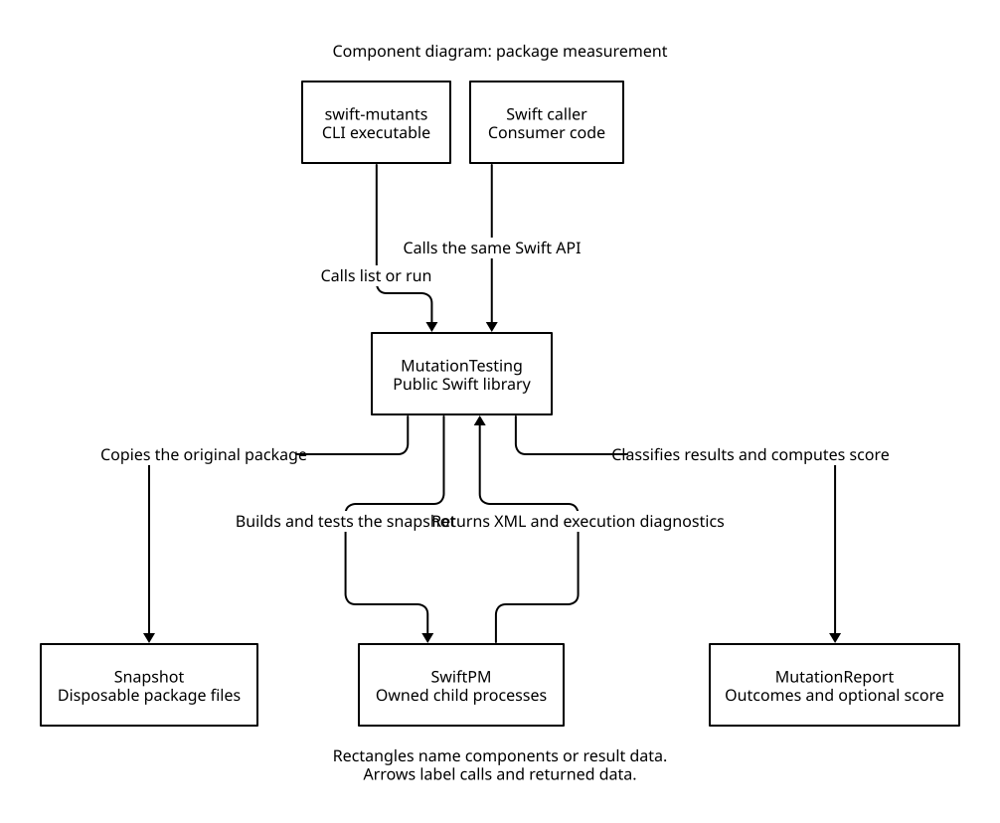
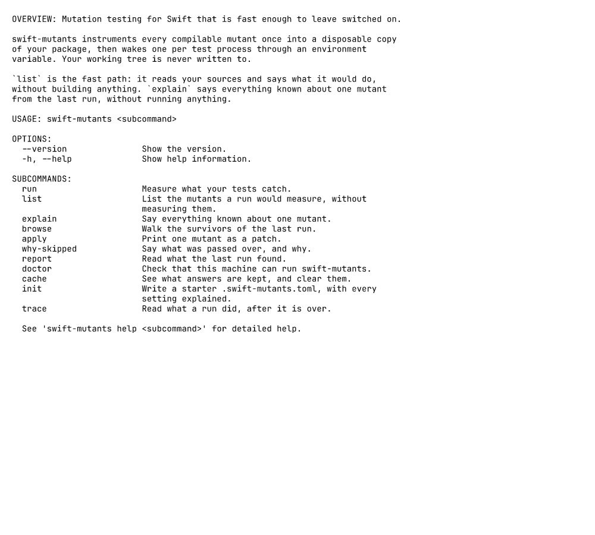
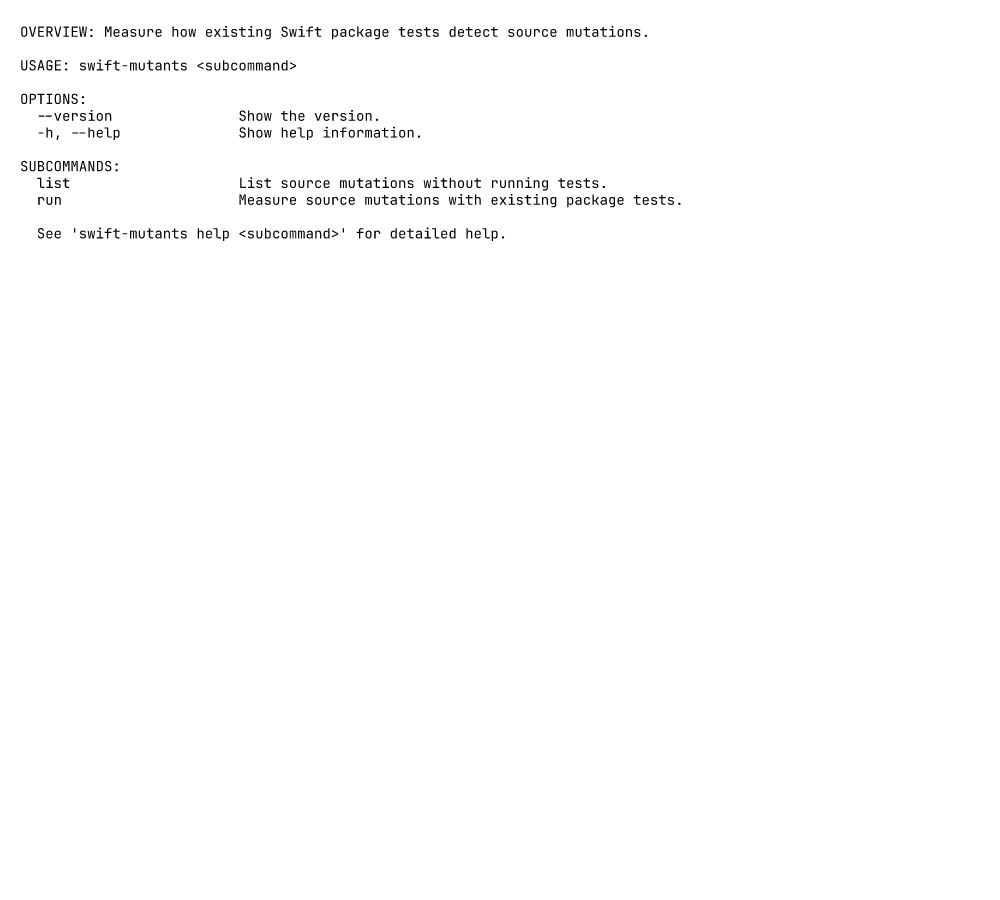

<!--
SPDX-FileCopyrightText: 2026 swift-mutants contributors
SPDX-License-Identifier: MIT OR Apache-2.0
-->

# Swift mutation testing

swift-mutants measures whether existing package tests detect source changes.
The `SwiftMutants` library discovers, applies, and measures mutations.
The CLI calls the same public API.

## Requirements

Measurement supports macOS 15 or later and Swift 6.3 or later.
The subject must be a SwiftPM package.
Swift Testing, XCTest, and mixed test targets work without changing tests.
Apple documents [coexistence of the test frameworks](https://developer.apple.com/documentation/xcode/adding-tests-to-your-xcode-project).

Xcode projects, Simulator, and UI tests aren't supported.
Sources, local dependencies, and fixtures must stay inside the package.
Snapshots reject symbolic links and special files.
SwiftPM resolves remote dependencies.
Measurement runs package manifests, builds, and tests with the caller's environment and permissions.

## Library

Add the library product to a consumer package:

```swift
// swift-tools-version: 6.3
import PackageDescription

let package = Package(
    name: "Consumer",
    platforms: [.macOS(.v15)],
    dependencies: [.package(path: "../swift-mutants")],
    targets: [
        .executableTarget(
            name: "Consumer",
            dependencies: [.product(name: "SwiftMutants", package: "swift-mutants")]
        ),
    ]
)
```

Discover and apply a source edit without I/O:

```swift
import SwiftMutants

let source = "func compare(_ a: Int, _ b: Int) -> Bool { a < b }"
let mutations = try Mutation.discover(in: source, at: "Sources/Subject.swift")
if let mutation = mutations.first(where: { $0.rule == "lt-to-le" }) {
    print(try mutation.applying(to: source))
}
```

Each mutation has an `id`, `path`, `rule`, `byteRange`, `original`, `replacement`, `line`, and `column`.
Offsets and columns count UTF-8 bytes.
Lines and columns start at one.
Source digests protect edits from stale input, including canonically equivalent Unicode with different bytes.
Editing preserves every byte outside the selected range.

List candidates and measure a package using existing tests:

```swift
import Foundation
import SwiftMutants

let package = URL(filePath: CommandLine.arguments[1])
let candidates = try await MutationTesting.list(
    packageAt: package,
    include: ["Sources/**/*.swift"],
    exclude: ["Sources/Generated/**"]
)
let report = try await MutationTesting.run(
    packageAt: package,
    options: RunOptions(
        include: ["Sources/**/*.swift"],
        exclude: ["Sources/Generated/**"],
        filter: [],
        skip: ["SlowTests"],
        timeout: .seconds(60),
        mutantIDs: []
    ),
    progress: { event in
        if case .measured(let result) = event {
            print(result.mutation.id, result.outcome)
        }
    }
)
print(report.score as Any)
```

Empty file selection includes every production Swift source owned by the package.
Test sources, dependency sources, plugins, and macros aren't mutation targets.
File patterns support `*`, `?`, and whole-component `**`.
Filters and skips use SwiftPM regular expressions.
Set `mutantIDs` to full identities from a previous result to repeat a selected measurement.
An unknown identity is an input error.

The library writes no console output.
The optional progress closure receives `RunEvent` values on the measurement task.
`MutationTestingError` identifies a failed stage and includes diagnostics.
Task cancellation stops owned processes, including descendants in separate process groups, before returning.
The library installs no process-wide signal handlers.

## CLI

Build the tool with `swift build -c release`.
List candidates before measuring:

```sh
.build/release/swift-mutants list --package-path /path/to/package
.build/release/swift-mutants run --package-path /path/to/package --strict
```

Both commands accept repeated `--include` and `--exclude` source patterns and `--json`.
The `run` command accepts repeated `--mutant`, `--filter`, and `--skip` options.
`--timeout` sets seconds for each complete baseline or mutant suite.
Quote globs and regular expressions to preserve shell characters.

Text output shows survivor locations, identities, edits, and outcome counts.
JSON includes every selected mutation, diagnostics, counts, and the optional score.
Measurement JSON uses `schemaVersion: 3`, with a distinct contract from historical reports.
Results go to stdout.
Progress and diagnostics go to stderr following the [CLI guidelines](https://clig.dev/#the-basics).

A complete measurement exits 0.
`--strict` exits 1 when a complete measurement has survivors.
Failed prerequisites, incomplete measurements, and an empty score denominator exit 2.
SIGINT, SIGTERM, and SIGHUP cancel measurement, wait for child cleanup, and exit with 128 plus the signal number.

## Measurement

Measurement copies the original package into a disposable snapshot before SwiftPM runs.
Original source files and existing reports stay unchanged.
Public SwiftPM build commands build the original and instrumented package.
Tests run through `swift test --skip-build`.
XCTest uses one worker on SwiftPM's parallel execution path to produce XML.
Each built test product gets its own invocation and XML output.
Swift Testing and XCTest XML paths follow the [SwiftPM implementation](https://github.com/swiftlang/swift-package-manager/blob/swift-6.3-RELEASE/Sources/Commands/SwiftTestCommand.swift#L444-L477).
SwiftPM's XCTest XML omits skips and represents abnormal exits as failures.
Measurement reconciles XML with XCTest completion records exposed by [SwiftPM's verbose output](https://github.com/swiftlang/swift-package-manager/blob/swift-6.3-RELEASE/Sources/Commands/SwiftTestCommand.swift#L1157-L1165).



The component diagram shows the shared public API and the disposable package boundary.
The [editable D2 source](assets/package-measurement.d2) keeps the relationships inspectable.

The original baseline must pass with at least one executed test.
Three inactive baselines must pass and match the original test identities and execution counts.
Changes to package files by tests stop measurement.
Each mutation faces the complete selected suite.
Guards compile once in the normal path.
After a guard build failure, measurement splits candidate groups to keep compatible instrumentation.
Only incompatible candidates fall back to individual source edits.
Guarded candidates execute before individual edits, while report results keep discovery order.
Only an individual edit's compiler rejection becomes `rejected`.

Outcomes are `killed`, `survived`, `rejected`, `timedOut`, and `errored`.
The `killed` outcome needs recorded test failure with valid output and matching executed and skipped test inventories.
Survival needs successful process completion and the baseline test executions.
Missing or malformed XML and abnormal exits never become survival.
The score is `killed / (killed + survived)`.
Timeouts and execution errors make the final score `nil`.
An empty denominator also produces `nil`, encoded as JSON `null`.

An explicit timeout overrides the defaults.
Baselines otherwise get five minutes.
Mutants get the greater of thirty seconds and five times the slowest baseline.
Build deadlines come from `CompileDeadline`.

The fixed nine families cover comparisons, boolean connectives and operand pruning, boolean literals, integer arithmetic, condition decisions, concatenation order, statement deletion, pattern matching, and error handling.
Measurement supports no profiles, configuration files, caches, coverage selection, simultaneous mutants, sharding, differential runs, compiler equivalence, custom mutations, expected survivors, history editing, or report projections.
Move source patterns from TOML to `--include` and `--exclude`, test selection to `--filter` and `--skip`, and deadlines to `--timeout`.
Remove the configuration file after migration.
Measurement preserves existing report files.

### CLI command migration

The previous CLI exposed configuration, cache, and history commands.



The library CLI exposes listing and measurement through the public API.



## Development

Run `mise run check` for static checks and unit tests.
Run `mise run test:integration` for compiler fixtures, real package measurements, and the external library consumer.
Run `mise run test:proof` with the Lean toolchain in `Proofs/lean-toolchain` for the measurement model and shared fixtures.
The [verification guide](verification.md) defines the proof boundary and focused self-mutation command.
The release gate runs optimized builds and the shipped executable.
Build counts verify reuse without imposing a timing threshold.

The [architecture records](adr/README.md) explain byte identities, instrumentation, and the public measurement boundary.
