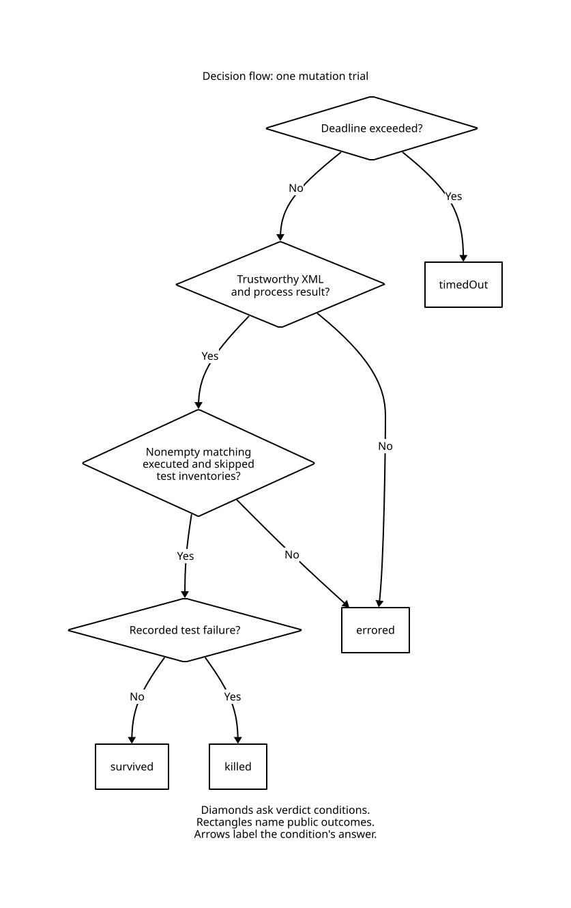

<!--
SPDX-FileCopyrightText: 2026 swift-mutants contributors
SPDX-License-Identifier: MIT OR Apache-2.0
-->

# Measurement verification

`mise run check` checks source structure, formatting, source licenses, workflows, secrets, and unit behavior.
`mise run test:integration` exercises real SwiftPM packages, Swift Testing, XCTest, mixed targets, build rejection, timeouts, crashes, cancellation, and an external library consumer.
The release gate checks optimized execution.

## Verdict and score contracts

The pure `TestVerdict.classify` policy uses timeout, trustworthy results, test inventory, and recorded failures.
Timeout takes precedence.
Only trustworthy results with a nonempty matching inventory can become killed or survived.
The inventory includes executed and skipped identities with multiplicities.



A recorded failure with a changed inventory produces `errored`.
The decision flow excludes compiler rejection, which comes from an individual edit's build.
The [editable D2 source](assets/measurement-verdict.d2) shows each condition and outcome.

`Proofs/Measurement.lean` proves the verdict conditions and score completeness over natural-number counts.
An available score has a positive denominator.
Compiler rejection doesn't affect the fraction.
Timeouts and execution errors prevent a score.

Run the proof command with the toolchain pinned in `Proofs/lean-toolchain`:

```sh
mise run test:proof
```

The committed Lake manifest lets CI configure the proof package with its recorded dependency state.
The command builds with warnings as errors and checks twelve theorems' axiom dependencies.
It replays each model with `leanchecker --fresh` and compares committed CSV fixtures with model-generated values.
The eight measurement theorems require no axioms.
The four range theorems depend on Lean's standard `propext` axiom.
Swift tests pass all 24 verdict input classes through the production observation adapter and compare every reason and public outcome with the shared fixture.
All 32 score presence classes and 1,024 count vectors check the public report.
The range model proves that valid nonnegative offsets can't underflow when adding a signed distance.
It proves that overflow addition followed by span validation agrees with the mathematical shift specification.
Swift checks 189 signed-boundary shifts with the shared fixture and an independent `Int128` oracle.
The column theorem bounds offset addition using a valid line interval and a validated column displacement.
An `Int128` oracle checks 86 source-position cases across Swift's line endings, line boundaries, and integer boundaries.
Independent byte and boundary sets check interval operations and strict-order laws over 45 spans.
The tests require complete class coverage and reject duplicate fixture rows.
CI requires both the Swift checks and the proof job.

The range model uses Swift's signed overflow addition semantics.
The models don't prove line-start construction, the Swift compiler, Foundation XML parsing, process supervision, or floating-point division.
Correspondence tests check the finite policy boundary.
Generated XML tests cover 1,024 documents with independent expected identities and counts.
Real package tests cover the framework output dialects and operating system behavior.
Source fixtures preserve UTF-8 byte order marks and CRLF endings through discovery, guarded measurement, and individual edits.
Fast decoding tests check byte preservation and reject malformed UTF-8 without invoking SwiftPM.
The shared line-break type follows [Swift's LF, CR, and CRLF grammar](https://github.com/swiftlang/swift-book/blob/main/TSPL.docc/ReferenceManual/LexicalStructure.md#whitespace-and-comments).
Line indexing and instrumentation use the same type and preserve other Unicode separators in literals.
A lightweight SwiftPM fixture checks process status, XML consistency, truncation, product identities, test selection, activation, and deadlines without invoking a compiler.
Recorded executions distinguish baseline from mutant commands and require no execution request after a suite budget expires.
XCTest completion records remain separate across unterminated standard output and standard error.
Streaming matcher tests cover every token split, overlapping tokens, invalid UTF-8, and output beyond the diagnostic limit.
Streaming line matches agree with complete-line predicates across every split in the correspondence fixtures.
An exhaustive bounded check compares 121 byte streams and 49 pattern combinations at every split.
Truncated output containing XCTest records can't conceal a missing XML inventory behind valid Swift Testing results.
Activation checks still require successful symbol-tool completion.
Environment round-trip tests cover descending allocation sizes, Unicode, equals signs, and activation integer boundaries.
The process adapter uses Swift Subprocess's [string environment configuration](https://github.com/swiftlang/swift-subprocess/blob/dbe21bd7dfd4ffef8c32588918542a8abfa1b54c/Sources/Subprocess/Configuration.swift#L584) to preserve values and delegate C string construction.
Complete Swift Testing XML can remain trustworthy after diagnostic truncation.
Streaming line checks detect abnormal exits beyond retained output.
Diagnostics identify abnormal test exits even when the original message follows the retained prefix.
XCTest still requires complete completion records, including skipped tests.
Truncated XCTest output produces a diagnostic that names the retention limit before completion reconciliation.
Generated completion tests cover 27 outcome sequences with repeated identities under both XML skip representations.
Completion reconciliation rejects missing, extra, repeated, and contradictory records.
Real packages check 2MiB diagnostic output and a crash after test completion.
A malformed fixture must fail the proof command even when Lake reuses build artifacts.

## Focused self-mutation

Build the CLI, then measure its critical result and source-range code:

```sh
swift build --product swift-mutants
.build/debug/swift-mutants run \
  --include Sources/SwiftMutants/MutationReport.swift \
  --include Sources/SwiftMutants/TestInvocation.swift \
  --include Sources/SwiftMutants/TestVerdict.swift \
  --include Sources/SwiftMutants/XUnitResults.swift \
  --include Sources/SwiftMutants/XCTestTranscript.swift \
  --include Sources/SwiftMutantsCore/SourceSpan.swift \
  --include Sources/SwiftMutantsRunner/OutputMatcher.swift \
  --include Sources/SwiftMutantsRunner/OutputLines.swift \
  --skip RepositoryGateTests --skip IntegrationTests --json
```

Repository gates inspect source text that instrumentation intentionally changes.
Integration tests build packages and belong in a separate verification tier.
The selected unit suites still execute in full for each mutation.
Inspect survivors, execution errors, and timeouts as distinct outcomes.
Add behavior tests for missing invariants, then rerun affected identities with `--mutant`.
Changes to production source require rediscovery because identities include the source digest.
Build events check normal two-build reuse and individual fallback without timing thresholds.
Test fixture constructors use `#require` so a broken production invariant records a failure without trapping the test process.
Production crashes remain execution errors and leave the score absent.
